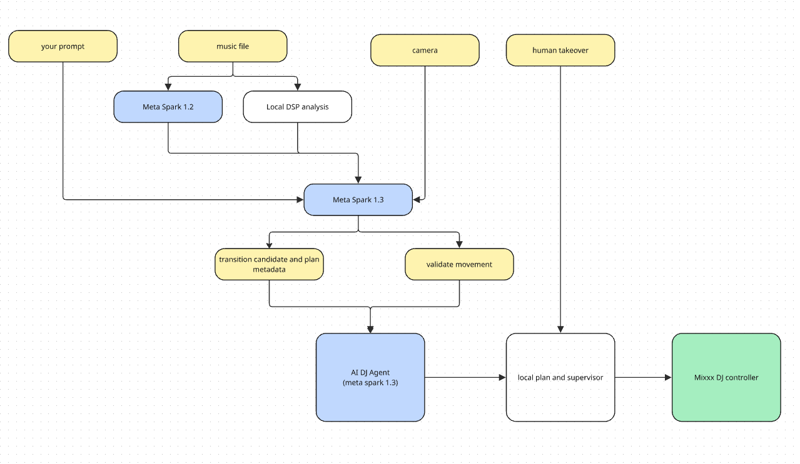

# autoDJ

**I wanted to dance at my own party, so I built an AI DJ.**

autoDJ uses Meta Muse Spark to understand music, select songs, and plan transitions.
A local controller performs those plans in Mixxx, while a webcam lets a person
request changes through predefined gestures. The dashboard shows what the AI
proposed, what was applied, and what the audio engine actually executed.

[Watch the demo](https://www.youtube.com/watch?v=k-gOUhyPsPI) ·
[Project repository](https://github.com/hhtzuhh/autoDJ)

Created by **Tzu-Han Lin (hhtzuhh)** for the **Meta Global AI Developer Hackathon**.

## What it does

- Builds a playlist from a natural-language request and a local music library.
- Plans ahead across multiple songs, selecting cues, tempo changes, crossfades,
  and low-EQ actions from locally validated options.
- Executes transitions through Mixxx using observed playback position and MIDI
  feedback. Human takeover cancels further automation.
- Uses camera gestures to request future changes. Holding up one index finger
  requests a different upcoming song order; arms up or crossed arms request more
  or fewer in-track effects. Meta can leave effects unchanged when no suitable
  action fits.
- Shows the preparation workflow, model responses, pending song order, and
  execution history in separate **Agent flow** and **Control room** views.

The demo shows automatic transitions and gesture-driven queue replanning. It
does not show the eventual audible handoff into the reordered song.

## Architecture



**Meta plans; the local executor performs.** Model responses are checked against
track identity, queue state, available cues, action limits, and timing before
execution. The model does not send a control command on every beat.

| Component | Role | Runs on |
| --- | --- | --- |
| Essentia DSP adapter | Beats, BPM, energy and audio features | Local Python process |
| Muse Spark 1.2 | Music descriptions from MP3/WAV audio | Meta Model API |
| Muse Spark 1.3 | Playlist selection, transition planning and gesture interpretation | Meta Model API |
| Supervisor and executor | Validate plans, schedule controls, observe execution and handle takeover | Local Python bridge |
| Mixxx | Decode, play and mix audio | Local desktop |
| Dashboard and camera service | Review plans, capture clips and expose model evidence | Local React/Vite and Node services |

The default analysis backend is **non-model DSP**. All-In-One remains an optional,
interchangeable adapter with separate caches; it is not required for the default
setup. See [runtime details](docs/STANDALONE_RUNTIME.md).

## Run locally

### Requirements

Verified setup: **Apple Silicon macOS, Python 3.11, Node.js 22.18 or newer,
Mixxx 2.5.6**, and **ffmpeg/ffprobe** on your PATH. Other operating systems have
not been verified. Live planning requires a Meta Model API key with access to
the models above. No sibling development workspace is required.

### Install

```sh
git clone https://github.com/hhtzuhh/autoDJ.git
cd autoDJ
python3.11 -m venv .venv
.venv/bin/python -m pip install -r requirements.txt
npm ci
cp .env.example .env
npm run data:init
```

Set `MODEL_API_KEY` in `.env`; keep `DJ_ANALYSIS_BACKEND=essentia_dsp` for the
default pipeline. Add at least two MP3/WAV songs you have permission to use to
`local-assets/samples-v3/`. Audio, credentials and generated results are ignored
by Git. The demo music is not bundled; its sources are listed below.

### Connect Mixxx

Follow the [Mixxx mapping setup](mixxx/README.md): enable the macOS IAC bus, copy
both supplied mapping files into Mixxx's user mapping folder, and enable the
**AI DJ programmatic control probe** mapping. Configure Mixxx's audio output.
If needed, set `MIXXX_MIDI_PORT` in `.env` to the exact port name.

### Start the services

Run each command in a separate terminal from the repository root:

```sh
# Terminal 1 — local bridge, port 8765
npm run bridge
```

```sh
# Terminal 2 — dashboard, port 5173
npm run dev
```

```sh
# Terminal 3 — optional webcam service, port 8767
npm run crowd
```

Open **http://127.0.0.1:5173/?source=live&view=flow**.

1. In **Select & order**, describe the playlist and choose a track count. Build
   completes missing DSP analyses and Meta music descriptions across the library
   before selecting songs; completed results are reused.
2. **Prepare transitions**, then **Export Mixxx playlist**.
3. Open the exported M3U8 in Mixxx, select its first row, and leave both decks
   stopped. Importing into the web app alone does not select the playlist in Mixxx.
4. **Build performance plan** to load and verify tracks and request the first
   Meta plan. Review it, then press **Start playback**.
5. For gesture interaction, open **Control room**, start webcam observation,
   and enable Adaptive DJ. Hold one index finger up for at least two seconds.
   Reordering needs at least two songs after the protected prefix, so use a
   longer set for this demonstration.

Use **Take over** to cancel automation. After takeover or a bridge restart,
rebuild the performance plan before starting again. Run only one bridge against
a Mixxx MIDI bus.

### Inspect without hardware or an API key

Run `npm ci` and `npm run dev`, then open **http://127.0.0.1:5173/** without
`source=live`. This is a **simulated UI with fixture data**, not a replay of real
model calls or audio playback. The linked video demonstrates the live system.

## Limits and evidence

- Camera interaction uses explicit demo gestures. Ordinary movement is recorded;
  it does not trigger replanning or establish whether an audience is happy.
- Capture, inference and planning take time. Reordering preserves the current
  and next prepared handoff and changes later songs at a verified boundary.
  A proposed order is not yet applied, and an applied order does not prove an
  audible handoff has completed.
- Stopping the camera or hiding its browser tab stops new observations but
  preserves already accepted requests until applied, cancelled or expired.
  Takeover cancels them; the original 120-second evidence limit still applies.
- DSP beats and bar alignment are estimates. Music descriptions are model
  outputs, not verified annotations. This version does not automatically avoid
  all vocal passages or provide source separation.
- Planning can time out or find no feasible continuation. The UI reports failures;
  an unattended, indefinitely reliable DJ set is not claimed.
- Music audio and webcam clips are sent to the Meta API for their respective
  analyses. Calls use API credits. Local recordings and responses are retained;
  remote clip deletion is attempted and failures are reported.

See [camera behavior and verification](docs/CROWD_OBSERVATION.md) and
[standalone runtime verification](docs/STANDALONE_RUNTIME.md).

## Development checks

```sh
npm run test:backend
npm run test:flow
npm run test:crowd
npm run build
.venv/bin/python scripts/smoke_dsp.py
```

The latest checks passed **328 backend tests, 40 frontend tests, 18 camera-service
tests, and the production build**. Tests use synthetic or mocked inputs where
appropriate. The separate DSP smoke check generates temporary audio, runs real
DSP analysis, builds transition candidates, and validates a synthetic executor
plan without Meta calls or MIDI playback. These checks do not measure musical
quality or gesture-recognition accuracy.

## Built during the hackathon

Project work includes the interchangeable analysis pipeline, Meta music-description
and playlist integration, rolling transition planner, camera gesture workflow,
React dashboard, and Mixxx mapping, observer, supervisor and execution integration.
Earlier prototypes from the same hackathon were adapted into this standalone
repository.

Mixxx, Essentia, React, and the Meta models are existing third-party projects and
services. The music was created by the credited artists. This project does not
claim to have built those tools, trained the models, or composed the demo tracks.

## Music Credits

The following tracks are selected for use in this Autonomous DJ demonstration:

### Dislocated — SampleSwap

- **[Blur](https://sampleswap.org/mp3/song.php?id=3539)** — Dislocated
- **[WBF91](https://sampleswap.org/mp3/song.php?id=3548)** — Dislocated
- **[Alarme](https://sampleswap.org/mp3/song.php?id=3558)** — Dislocated

Source: [Dislocated on SampleSwap](https://sampleswap.org/artist/DiSloCaTed)

License: [Creative Commons Attribution 3.0 Unported (CC BY 3.0)](https://creativecommons.org/licenses/by/3.0/)

Verified on 2026-11-04: the artist listing and the individual pages for these
three tracks label them Attribution and link to CC BY 3.0. Other tracks on the same
artist page have different licenses; this confirmation covers only the three above.

### JMHBM — Free Music Archive

- **[Senseless](https://freemusicarchive.org/music/beat-mekanik/single/senseless/)** — JMHBM. Source: Free Music Archive. License: [CC BY 4.0](https://creativecommons.org/licenses/by/4.0/).
- **[Keepsake](https://freemusicarchive.org/music/beat-mekanik/single/keepsake-1/)** — JMHBM. Source: Free Music Archive. License: [CC BY 4.0](https://creativecommons.org/licenses/by/4.0/).
- **[Only Now](https://freemusicarchive.org/music/beat-mekanik/single/only-now/)** — JMHBM. Source: Free Music Archive. License: [CC BY 4.0](https://creativecommons.org/licenses/by/4.0/).

Composer/producer: Johnathon M. Horner (Beat Mekanik). The FMA track listings
identify all three licenses as Attribution 4.0 International. Personal and
commercial use, including adaptations, is allowed under the license terms.

For Keepsake, the artist additionally requests credit to producer **@beatmekanik**,
courtesy of Free Music Archive under Creative Commons 4.0 International; on
Facebook, Instagram, or Threads, use **Music by @beat.mekanik**.

### Additional tracks — Free Music Archive

- **[Background](https://freemusicarchive.org/music/1000-handz/cc-by-free-to-use-dancehouse-instrumentals/background-1/)** — 1000 Handz ([1000Handz.com](https://1000handz.com)). Source: Free Music Archive. License: [CC BY 4.0](https://creativecommons.org/licenses/by/4.0/).
- **[AUX ★ Original Mix](https://freemusicarchive.org/music/akira-sora/single/aux-original-mix/)** — Akira Sora. Source: Free Music Archive. License: [CC BY 4.0](https://creativecommons.org/licenses/by/4.0/).

Both FMA track listings identify Attribution 4.0 International. Personal and
commercial use, including adaptations, is allowed under the license terms.

### Use in this demonstration

The tracks may be modified through automated beatmatching, tempo adjustment,
transitions, and mixing. All music rights remain with their respective copyright
holders. The artists do not endorse this project.
This source/license check does not certify that the tracks contain no vocals.

For publication, include these credits and source/license links in the video
description, retain supplied notices, and identify the modifications actually
used. The list documents the demonstration library; the final edit may use only
excerpts from a subset of these tracks.
